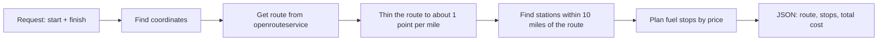

# Fuel Route API


A Django API that takes a start and finish location in the USA and returns the driving route, the cheapest places to fuel up along it, and the total fuel cost.

The vehicle has a 500-mile range and gets 10 miles per gallon, so long trips need several fuel stops. Fuel prices come from the supplied OPIS CSV file.


## Features

- Route and fuel-stop planning for any two US locations
- Stops chosen to minimise total fuel cost, never leaving a gap longer than 500 miles
- Returns the route as GeoJSON, plus each stop with price, gallons and cost
- Built-in map page (Leaflet) to see the result
- Few external calls: one routing call per request, and repeat requests need none
- Unit tests for the stop-planning logic

## Quick start

You need Python 3.12 or newer and a free openrouteservice key from [account.heigit.org](https://account.heigit.org/).

```powershell
# 1. Get the code
git clone https://github.com/Urwa2204/fuel-route-api.git
cd fuel-route-api

# 2. Create and activate a virtual environment
python -m venv venv
venv\Scripts\Activate.ps1          # Mac/Linux: source venv/bin/activate

# 3. Install and set up the database
pip install -r requirements.txt
python manage.py migrate
python manage.py loaddata stations  # pre-geocoded fuel stations, loads in seconds

# 4. Add your key and start the server
$env:ORS_API_KEY="your_key_here"    # Mac/Linux: export ORS_API_KEY=your_key_here
python manage.py runserver
```

Then open:

- Map page: http://127.0.0.1:8000/
- API: http://127.0.0.1:8000/api/route/?start=Chicago, IL&finish=Dallas, TX

## API

### `GET /api/route/` or `POST /api/route/`

| Field | Type | Description |
|---|---|---|
| `start` | string | A place name (`"Chicago, IL"`) or coordinates (`"41.88,-87.63"`) |
| `finish` | string | Same format as `start` |

For `POST`, send JSON: `{"start": "Chicago, IL", "finish": "Dallas, TX"}`.

Example response (route coordinates shortened):

```json
{
  "start": {"label": "Chicago, IL, USA", "lat": 41.879, "lon": -87.661},
  "finish": {"label": "Dallas, TX, USA", "lat": 32.736, "lon": -96.784},
  "distance_miles": 971.2,
  "fuel_stops": [
    {
      "stop": 1,
      "name": "HUCKS FOOD & FUEL #379",
      "city": "Marion",
      "state": "IL",
      "miles_from_start": 252.1,
      "price_per_gallon": 2.929,
      "gallons": 25.21,
      "cost": 73.85
    }
  ],
  "total_gallons": 47.12,
  "total_fuel_cost": 136.16,
  "route": {"type": "LineString", "coordinates": [[-87.66, 41.87], "..."]},
  "elapsed_ms": 9448
}
```

Errors come back as JSON with a clear message:

| Status | When |
|---|---|
| `400` | Missing field, a place that can't be found, or no fuel station within range |
| `502` | The routing service is unreachable |

### Checking the numbers

For the example above: 971.2 miles at 10 mpg needs 97.1 gallons. The car starts with a full tank (50 gallons), so 47.1 gallons are bought along the way, which matches `total_gallons`.

## How it works



1. **Stations are geocoded once, ahead of time.** The CSV has highway exits but no coordinates. A management command looks up each distinct city once and saves the result, so no geocoding happens during a request.
2. **One routing call per request.** Place names add two geocoding calls (three in total). Passing `lat,lon` skips those, leaving a single call. All results are cached, so repeating a request makes no external calls.
3. **Stations near the route are found with a KD-tree.** The route is thinned to about one point per mile, then every station is matched to its nearest route point in milliseconds.
4. **A greedy planner chooses where to stop.** At each stop it asks whether a cheaper station is reachable on a full tank. If so, it buys only enough fuel to get there. If not, it fills up and moves on to the cheapest station in reach. It buys just enough to finish when the destination is in range.

## Data preparation

The fixture in `routing/fixtures/stations.json` already contains the geocoded stations. To rebuild it from the original CSV (about 75 minutes, because the free geocoder allows one request per second):

```powershell
python manage.py import_stations fuel-prices-for-be-assessment.csv
python manage.py geocode_stations
```

What the import does with the CSV:

- Removes Canadian stations (the task is USA only)
- Keeps the lowest price where a station ID appears more than once
- Loads 6,626 US stations; 6,624 are geocoded

## Performance

| Request | Time |
|---|---|
| First request after server start (loads stations, makes the external calls) | 8.44 s |
| Same route again (served from cache) | 0.05 ms |

## Configuration

Set in `config/settings.py`:

| Setting | Default | Meaning |
|---|---|---|
| `ORS_API_KEY` | from environment | openrouteservice key, never stored in code |
| `VEHICLE_RANGE_MILES` | 500 | Maximum distance on a full tank |
| `VEHICLE_MPG` | 10 | Fuel economy |
| `MAX_DETOUR_MILES` | 10 | How far from the route a station may be |

## Project structure

```
fuel-route-api/
├── config/                         Django project settings and URLs
├── routing/
│   ├── models.py                   FuelStation model
│   ├── geo.py                      Distance maths and KD-tree station lookup
│   ├── planner.py                  Fuel-stop planning logic
│   ├── services.py                 Routing API calls, caching, request pipeline
│   ├── views.py                    API endpoint and map page
│   ├── tests.py                    Unit tests for the planner
│   ├── fixtures/stations.json      Pre-geocoded stations
│   ├── management/commands/        import_stations, geocode_stations
│   └── templates/routing/map.html  Leaflet map page
├── manage.py
└── requirements.txt
```

## Tests

```powershell
python manage.py test
```

The tests cover a short trip (no stops needed), a long trip with the expected stops, gallons and cost, and a route with no fuel station in range.

## Assumptions and limitations

- The vehicle starts with a full tank. `total_fuel_cost` covers fuel bought along the way, so trips under 500 miles cost $0.
- Stations are placed at their city's coordinates, not their exact address, because the CSV only gives highway exit descriptions. Only stations within 10 miles of the route are considered.
- Because the planner minimises cost, it may make several smaller purchases when a slightly cheaper station is reachable, rather than fewer large ones.
- Prices come from a single snapshot in the CSV and are not updated live.

## Possible improvements

- Geocode exact station addresses for more precise stop locations
- Offer a "fewest stops" mode alongside the "lowest cost" mode
- Use a shared cache such as Redis so cached routes survive restarts and work across servers
- Add tests for the API layer with the routing service mocked

## Credits

Routing and geocoding by [openrouteservice](https://openrouteservice.org/). Map display by [Leaflet](https://leafletjs.com/) with [OpenStreetMap](https://www.openstreetmap.org/copyright) contributors.