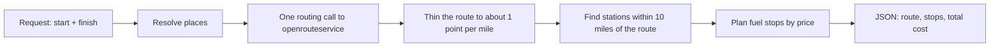

# Fuel Route API


A Django API that takes a start and finish location in the USA and returns the driving route, the cheapest places to fuel up along it, and the total fuel cost.

The vehicle has a 500-mile range and gets 10 miles per gallon, so long trips need several fuel stops. Fuel prices come from the supplied OPIS CSV file.


## Features

- Route and fuel-stop planning for any two US locations
- Stops chosen to minimise total fuel cost, never leaving a gap longer than 500 miles
- Returns the route as GeoJSON, plus each stop with price, gallons and cost
- Web interface (Leaflet) with summary cards, a clickable list of stops and numbered map markers
- One call to the routing service per request for typical "City, ST" input; repeat requests need none
- Unit tests for the stop-planning logic

## Quick start

You need Python 3.12 or newer and a free openrouteservice key from [account.heigit.org](https://account.heigit.org/).

```powershell
# 1. Get the code
git clone https://github.com/Urwa2204/fuel-route-api.git
cd fuel-route-api

# 2. Create and activate a virtual environment
python -m venv venv
venv\Scripts\Activate.ps1          # Mac/Linux: source venv/bin/activate

# 3. Install and set up the database
pip install -r requirements.txt
python manage.py migrate
python manage.py loaddata stations  # pre-geocoded fuel stations, loads in seconds

# 4. Add your key and start the server
$env:ORS_API_KEY="your_key_here"    # Mac/Linux: export ORS_API_KEY=your_key_here
python manage.py runserver
```

Then open:

- Web interface: http://127.0.0.1:8000/
- API: http://127.0.0.1:8000/api/route/?start=Chicago, IL&finish=Dallas, TX

The key is read from the environment and is never stored in the code. See `.env.example`.

## API

### `GET /api/route/` or `POST /api/route/`

| Field | Type | Description |
|---|---|---|
| `start` | string | `"City, ST"` (for example `"Chicago, IL"`), another place name, or coordinates (`"41.88,-87.63"`) |
| `finish` | string | Same format as `start` |

For `POST`, send JSON: `{"start": "Chicago, IL", "finish": "Dallas, TX"}`. Field names must be lowercase.

Example response for New York to Los Angeles (stops and route shortened):

```json
{
  "start": {"label": "New York, NY, USA", "lat": 40.68295, "lon": -73.9708},
  "finish": {"label": "Los Angeles, CA, USA", "lat": 34.05513, "lon": -118.25703},
  "distance_miles": 2798,
  "fuel_stops": [
    {
      "stop": 1,
      "name": "SHEETZ #639",
      "address": "I-80 Exit 223",
      "city": "Youngstown",
      "state": "OH",
      "miles_from_start": 397.2,
      "price_per_gallon": 3.059,
      "gallons": 6.22,
      "cost": 19.03
    }
  ],
  "total_gallons": 229.8,
  "total_fuel_cost": 703.82,
  "route": {"type": "LineString", "coordinates": [[-73.97083, 40.68295], "..."]},
  "elapsed_ms": 6716
}
```

The full response for this route has 13 stops, and the longest gap between fuel points is 445.7 miles.

Errors come back as JSON with a clear message:

| Status | When |
|---|---|
| `400` | Missing field, a place that can't be found, or no fuel station within range |
| `502` | The routing service is unreachable |

### Checking the numbers

For the example above: 2,798 miles at 10 mpg needs 279.8 gallons. The car starts with a full tank (50 gallons), so 229.8 gallons are bought along the way, which matches `total_gallons`. The stop costs add up to `total_fuel_cost`.

## How it works



1. **Stations are geocoded once, ahead of time.** The CSV has highway exits but no coordinates. A management command looks up each distinct city once and saves the result, so no geocoding of stations happens during a request.
2. **Places are resolved locally when possible.** A `"City, ST"` that matches a city in the station data is looked up in memory with no external call. Other place names use the openrouteservice geocoder (both lookups run in parallel), and `lat,lon` input skips geocoding altogether. All results are cached.
3. **One routing call per request.** The route and its distance come from a single directions call, which is cached per start/finish pair.
4. **Stations near the route are found with a KD-tree.** The route is thinned to about one point per mile, then every station is matched to its nearest route point in milliseconds.
5. **A greedy planner chooses where to stop.** At each stop it asks whether a meaningfully cheaper station is reachable on a full tank. If so, it buys only enough fuel to get there. If not, it fills up and heads for the farthest station priced within a few cents of the cheapest one in reach. It buys just enough to finish when the destination is in range.

## Data preparation

The fixture in `routing/fixtures/stations.json` already contains the geocoded stations. To rebuild it from the original CSV (about 75 minutes, because the free geocoder allows one request per second):

```powershell
python manage.py import_stations fuel-prices-for-be-assessment.csv
python manage.py geocode_stations
```

What the import does with the CSV:

- Removes Canadian stations (the task is USA only)
- Keeps the lowest price where a station ID appears more than once
- Loads 6,626 US stations; 6,624 were geocoded automatically (2 city names weren't matched by the geocoder and are left out of route searches)

## Performance

| Request | Time |
|---|---|
| First request after server start (loads stations, one routing call) | about 6 s (5.7 s and 6.7 s measured on New York to Los Angeles) |
| Same route again (served from cache) | XX ms |
| Before optimisation (two geocoder calls plus the routing call) | about 9 to 13 s |

Almost all of the first-request time is the single call to the external routing service. The planning itself (station lookup and stop selection) takes a few milliseconds.

## Configuration

Set in `config/settings.py`:

| Setting | Default | Meaning |
|---|---|---|
| `ORS_API_KEY` | from environment | openrouteservice key, never stored in code |
| `VEHICLE_RANGE_MILES` | 500 | Maximum distance on a full tank |
| `VEHICLE_MPG` | 10 | Fuel economy |
| `MAX_DETOUR_MILES` | 10 | How far from the route a station may be |
| `MIN_PRICE_SAVING` | 0.03 | Ignore stations cheaper by less than this ($ per gallon) |
| `MIN_LEG_MILES` | 100 | Don't hop to a "cheaper" station closer than this |
| `SECURE_REFERRER_POLICY` | `strict-origin-when-cross-origin` | Lets the map tiles load (OpenStreetMap requires a referrer) |

## Project structure

```
fuel-route-api/
├── config/                         Django project settings and URLs
├── routing/
│   ├── models.py                   FuelStation model
│   ├── geo.py                      Distance maths and KD-tree station lookup
│   ├── planner.py                  Fuel-stop planning logic
│   ├── services.py                 Place lookup, routing call, caching, request pipeline
│   ├── views.py                    API endpoint and web page
│   ├── tests.py                    Unit tests for the planner
│   ├── fixtures/stations.json      Pre-geocoded stations
│   ├── management/commands/        import_stations, geocode_stations
│   └── templates/routing/map.html  Web interface (Leaflet)
├── docs/                           Screenshots for this README
├── manage.py
└── requirements.txt
```

## Tests

```powershell
python manage.py test
```

The tests cover a short trip (no stops needed), a long trip with the expected stops, gallons and cost, and a route with no fuel station in range.

## Assumptions and limitations

- The vehicle starts with a full tank. `total_fuel_cost` covers fuel bought along the way, so trips under 500 miles cost $0.
- Stations are placed at their city's coordinates, not their exact address, because the CSV only gives highway exit descriptions. Only stations within 10 miles of the route are considered.
- Places such as `"Chicago, IL"` are located at the city centre taken from the station data, so distances can differ slightly from a street-address search.
- Because the planner minimises cost, it can still make small top-up purchases when a slightly cheaper station is reachable, rather than fewer large ones.
- Prices come from a single snapshot in the CSV and are not updated live.

## Development notes

What changed during development, and why:

| Change | Reason |
|---|---|
| Stations geocoded once with a management command and saved in a fixture | The CSV has no coordinates, and geocoding at request time would be slow and rate-limited |
| KD-tree lookup of stations near the route | Matching thousands of stations to the route takes milliseconds |
| Planner ignores "cheaper" stations that save under 3 cents or are under 100 miles away | Removed pointless tiny stops, such as stopping to buy about 1 gallon |
| When filling up, the planner goes to the farthest station priced within 3 cents of the cheapest | Cut short back-to-back hops (New York to Los Angeles went from 14 stops to 13 in a real run) |
| `"City, ST"` resolved from the station data instead of the geocoder | The two geocoding calls took about 7 s of a roughly 13 s request |
| The two geocoder lookups run in parallel, with one reused HTTP connection | Faster when a place name is not in the station data |
| Routing request allows snapping to any nearby road | City centres are not always within a few hundred metres of a road |
| Web interface redesigned with a side panel, summary cards and a stop list | Easier to read and demonstrate than the first prototype |
| Referrer policy set for the map page | OpenStreetMap tile servers blocked requests that had no referrer |
| Cache keys are hashed | Place names with spaces and commas caused cache warnings |

## Possible improvements

- Geocode exact station addresses for more precise stop locations
- Offer a "fewest stops" mode alongside the "lowest cost" mode
- Use a shared cache such as Redis so cached routes survive restarts and work across servers
- Add tests for the API layer with the routing service mocked

## Credits

Routing and geocoding by [openrouteservice](https://openrouteservice.org/). Map display by [Leaflet](https://leafletjs.com/) with [OpenStreetMap](https://www.openstreetmap.org/copyright) contributors.